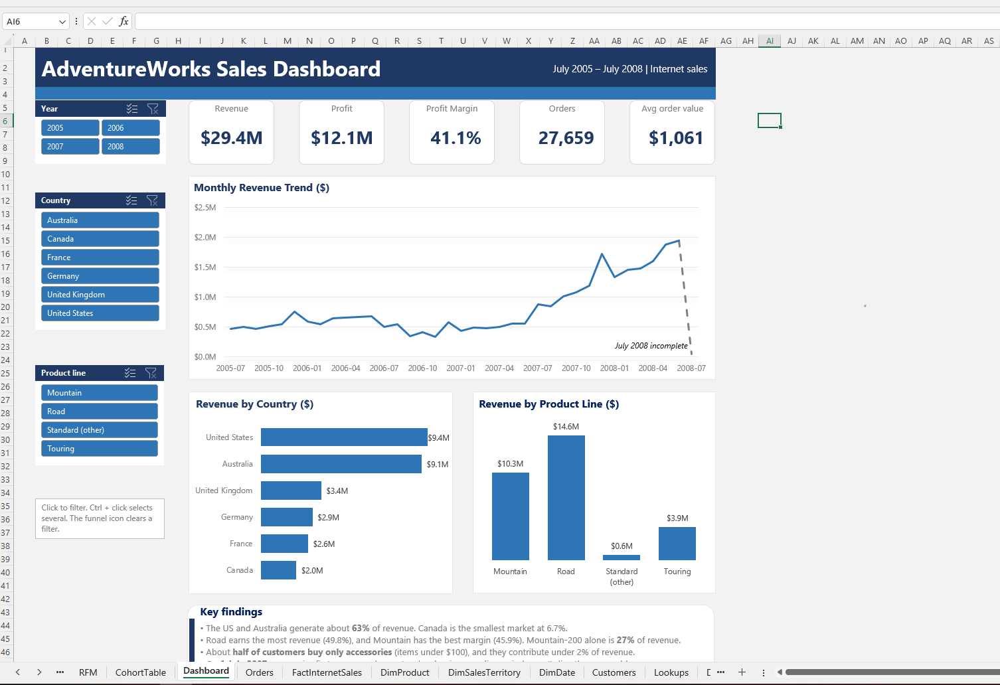

# AdventureWorks Sales Analysis (Excel 2016)

An end-to-end analysis of a fictional bicycle company's online sales, built in Microsoft Excel 2016 and finished with a one-page interactive dashboard.

## About the project

- **Data:** Microsoft's AdventureWorks practice dataset (internet sales, July 2005 to July 2008)
- **Size:** 60,398 items sold, 27,659 orders, 18,484 customers
- **Headline numbers:** $29.4M revenue, $12.1M profit, 41.1% margin
- **Goal:** find out what sold, where, to whom and when, and to practise honest, checkable analysis

## What is in this repository

| File | What it is |
|---|---|
| [AdventureWorks Sales Analysis Portfolio Summary.pdf](AdventureWorks%20Sales%20Analysis%20Portfolio%20Summary.pdf) | Plain-language summary of all nine projects |
| [AdventureWorks_Dashboard.pdf](AdventureWorks_Dashboard.pdf) | The one-page dashboard (static copy) |
| [screenshotdashboard.png](screenshotdashboard.png) | Image of the dashboard |
| [AdventureWorks_Dashboard.xlsx (Google Drive)]https://docs.google.com/spreadsheets/d/1xFd_HODR1D9sIdSpoSc4D0FRneqrWFsI/edit?usp=sharing&ouid=111716562478323141475&rtpof=true&sd=true | The workbook with formulas and PivotTables |

## The nine projects

**Beginner**

1. **Sales trend:** revenue and profit by year and month
2. **Products:** best and worst sellers, and how accessories changed the average order
3. **Geography:** sales and margin by country

**Intermediate**

4. **Customer profile:** who buys what, using income, education, cars and children
5. **Product mix:** product lines, models, colours and sizes
6. **Seasonality:** weekday, month and fiscal-year patterns

**Advanced**

7. **Customer groups (RFM):** scoring customers on recency, frequency and spend
8. **Repeat buying (cohorts):** do customers come back, compared fairly
9. **Dashboard:** KPI cards, charts and slicers on one page

## Key findings

- The United States and Australia bring in about **63%** of revenue.
- The Mountain-200 model alone is **27%** of revenue, and ten models make up **93%**.
- About **half of customers buy only cheap accessories** and contribute under 2% of revenue.
- About 12% of customers ("Champions") produce **38%** of revenue.
- Looking at fiscal years (July to June) revealed an **18.5% drop in FY2007** that calendar years hid.
- Nobody ordered twice before **1 July 2007**, the same day accessories first appeared.

## Skills shown

Excel Tables, INDEX/MATCH and VLOOKUP, SUMIFS and COUNTIFS, nested IF logic, PivotTables and PivotCharts, calculated fields, date and fiscal-calendar analysis, RFM customer scoring, cohort analysis, slicers and dashboard design.

## Checks I made along the way

- Every new calculation was tied back to the $29.4M total.
- I compared like with like (same months, same observation windows).
- I checked columns for real variation. The delivery dates were identical for every order, so I did not analyse delivery.
- I tested my own explanations, and two of them changed after checking the data.

## Limits

- This is a practice dataset, not a real company's records.
- The data has no product-category table, so "bike versus accessory" is approximated by price (under $100).
- The years 2005 and 2008 are partial, and July 2008 is almost empty.
- The patterns are associations, not proof of cause.

## Data source

The data comes from Microsoft's AdventureWorks sample databases, which describe a fictional bicycle company. Microsoft publishes its SQL samples under the MIT license: https://learn.microsoft.com/en-us/sql/samples

I worked from an Excel version of the data downloaded from: https://selar.com/235xdv3727

## About me

**Robert Mwawasi**, learning data analysis and building a portfolio. Next steps: SQL, Power BI and Power Query on the same dataset.

LinkedIn: https://www.linkedin.com/in/robert-mwawasi
